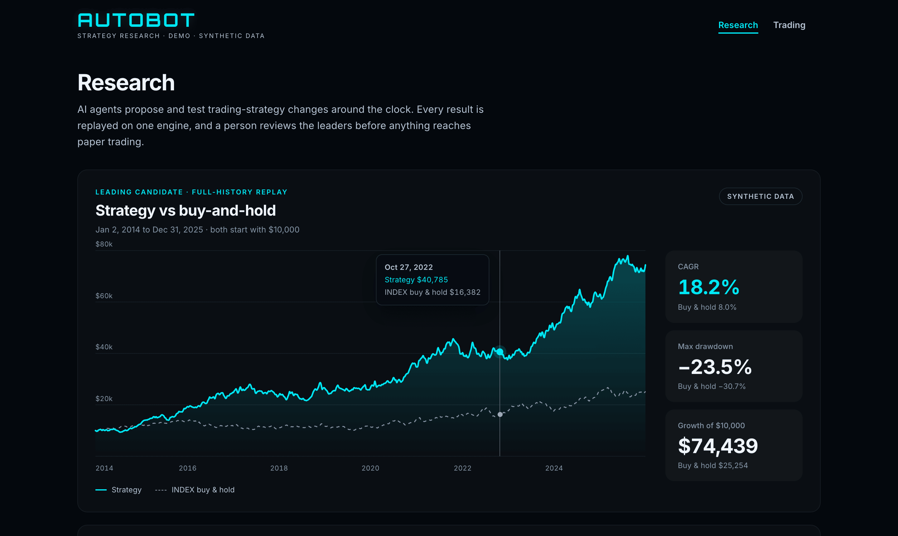
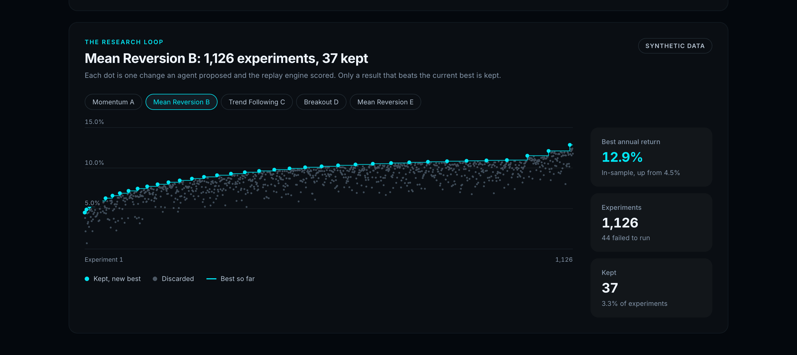
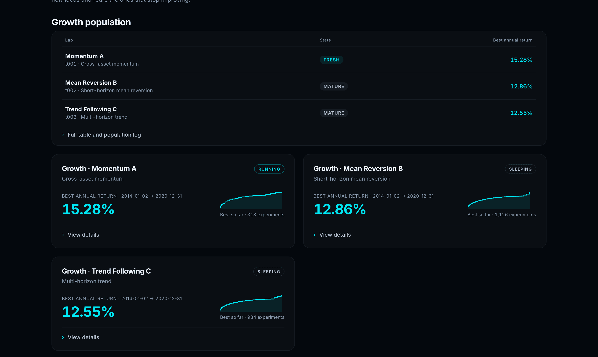
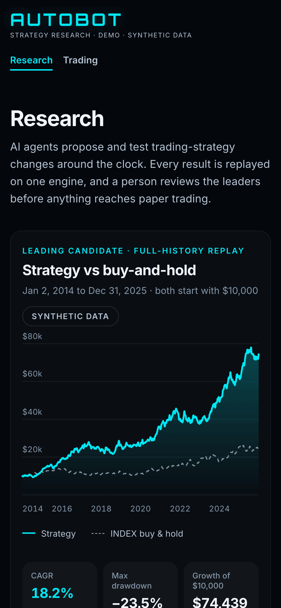

Demo version of my Autobot system, running on sample data. The live system runs privately.

**Live demo:** https://autobot-demo.netlify.app

# Autobot

A research system where AI agents build and test trading strategies around the clock, and a person decides what moves forward.



## Scale and timeline

| | |
|---|---|
| Time in development | 21 months (January 2025 to October 2026) |
| Commits across the private repositories | 479 |
| Commits in this demo's history | 74 |
| Hand-built strategy versions before automation | 27 |
| Automated research labs | 36 |
| Experiments recorded by those labs | 23,000+ |

This repository keeps the real commit history of the dashboard, its tests and its agent definitions, rewritten to remove private details. Everything else stays in the private system.

## What it does

Autobot runs strategy research as a continuous, supervised process. Each research lab owns one candidate strategy and an AI agent that keeps proposing changes, testing them and recording the result. Labs are grouped into populations that grow and prune themselves: new trajectories explore, mature ones refine, and a trajectory that stops improving gives up its slot.

Every result runs through one replay engine under one versioned execution contract, so results stay comparable and every figure can be traced to the exact rules and data that produced it. The dashboard is the review surface. It shows what every lab is doing, what it has found, and how the leading candidate behaves across the full history, so a person can judge it before anything reaches paper trading.

## How it works

1. **Automated research.** Labs run in cycles. An agent reads the lab's results, edits the candidate, runs it and keeps the change only if it beats the lab's current best.
2. **Testing.** A canonical replay engine evaluates every candidate against a versioned dataset and contract. Missing data produces an explicit "no rebalance", never an invented price.
3. **Evaluation.** Candidates are scored in-sample, then checked across separate market regimes. Data reserved for final validation is never visible to the search.
4. **Human review.** The dashboard puts each lab's state, best result, history and full-period replays side by side for a decision.
5. **Paper trading.** An approved candidate runs on live data with no capital at risk, reported separately from research results.

More detail in [docs/HOW_IT_WORKS.md](docs/HOW_IT_WORKS.md) and the principles behind it in [docs/OPERATING_PRINCIPLES.md](docs/OPERATING_PRINCIPLES.md).

## Architecture

```
 research labs (one per trajectory)        replay engine + execution contract
 agent cycles, results, champions   --->   versioned dataset, fills, costs, cash
            |                                          |
            v                                          v
  status projection (Python): reads each lab's published files, cheaply, on request
            |
            v
  dashboard server (Node/Express): Research, Trading and replay APIs
            |
            v
  single-page dashboard (vanilla JS, hand-built SVG charts)
```

- Each lab is a long-running service with a supervisor that alternates work and sleep cycles. A watchdog restarts anything that stalls.
- Labs publish plain files: a results ledger, the current champion, cycle status and a journal. The dashboard reads those files and never runs an evaluator or acquires a research lock, so viewing can't disturb research.
- In this demo the status projection is replaced by `demo-data/`, a synthetic snapshot of the same API payloads. When `AUTOBOT_ROOT` points at a checkout with `status.py`, the same server reads a live system instead.

## Tech stack

- **Research and replay:** Python 3.12, pandas, NumPy, Apache Arrow, exchange calendars, pytest
- **Agents:** LLM coding agents run through OpenCode, one per research lab
- **Dashboard:** Node.js, Express, a dependency-free single-page frontend with hand-built SVG charts
- **Operations:** Linux VPS, systemd services and timers, Git as the record of every deployed change
- **Testing:** Node's built-in test runner, a stubbed-DOM render check of every dashboard stage, and browser QA with agent-browser

## Screenshots

**The research loop.** Every experiment one lab has run. Each dot is a change an agent proposed and the replay engine scored; the few that beat the current best are kept and raise the bar.



**Strategy labs.** Each lab's state and best result at a glance, with a sparkline of its progress. Trade statistics, supervisor state and experiment history sit behind View details.



**Phone layout.**



## My role

I designed and built Autobot end to end: the research process and its guardrails, the replay engine and execution contract, the agent-driven research labs and their supervisors, the dashboard, and the operations that keep it running.

## Run it locally

Requires Node.js 18 or later.

```bash
npm install
npm start
```

Then open http://127.0.0.1:3000. The data is synthetic and regenerates deterministically:

```bash
npm run generate-demo-data   # rewrite demo-data/api/*.json
npm test                     # server, render and demo-mode tests (the server tests use python3 for stub scripts)
npm run build:static         # dist/: the same dashboard as a static site
```

Optional settings are listed in [.env.example](.env.example).

Everything under `demo-data/` is invented: lab names, strategies, equity curves and counts. The sample strategies in `demo-data/strategies/` are textbook examples, not the strategies the live system runs.

---

Interested in building on this together? Get in touch: [jonwest.dev](https://jonwest.dev) · [LinkedIn](https://www.linkedin.com/in/jonathonwestbrook)
